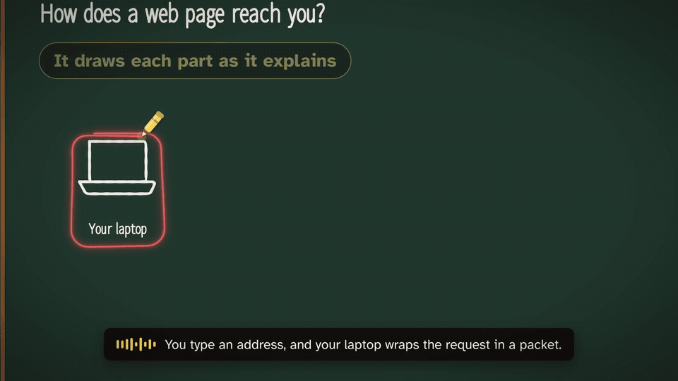

# Whiteboard Tutor

A Claude artifact that teaches any topic on a board. Claude draws each part while its voice explains it, and quizzes you as you go.

[Watch the 30-second demo](media/demo.mp4)

## Install (about 2 minutes)

1. **[Download Whiteboard-Tutor.zip](https://github.com/Nitya206/whiteboard-tutor/releases/latest/download/Whiteboard-Tutor.zip)**
2. Open a new chat on [claude.ai](https://claude.ai), attach the zip and send:
   > Unzip this and install Whiteboard Tutor for me as my own artifact. Follow INSTALL.md inside it exactly.
3. Claude publishes it into your account and gives you a link. Open it, type a topic, press **Start this topic**.

No GitHub account needed. The zip holds one HTML file plus the instructions Claude follows to install it, so you can read everything before you run it.

## What it does

- Type any topic. Claude draws it on the board piece by piece while its voice explains each part.
- Pause anytime and click anything on the board to ask about it.
- Slide not landing? **Show it another way** redraws the idea with a different picture, even halfway through.
- Circle a part of the board yourself and ask about it.
- Answer out loud instead of typing.
- A small C runner is built in, so code topics can be "predict the output, then run it".
- Read-along mode if you'd rather read than listen.

## Teach your own course, your way

1. In a normal Claude chat, describe your subject and how you like to be taught: exam style, depth, the kind of examples that work for you. Ask Claude to turn that into a study prompt for Whiteboard Tutor.
2. In the app, open **Study a topic** > **My study prompts, one per subject**. Pick or add your subject code (3 letters and 3 numbers, like `PHY101`) and paste the prompt in.
3. Start topics with that code, like `PHY101: how lenses focus light`, and the tutor follows your prompt. Paste your syllabus, notes or old exam papers in the box above Start and it teaches from those too.

## Before you try it

- Free accounts can install it, but the voice needs a paid plan. On free it runs as read-along cards.
- The voice plays in desktop Chrome or Edge, and only if your account has Claude's voice for artifacts. In Safari and the Claude mobile apps there's no voice.
- It starts on the **Saver** model setting (Sonnet for everything), the fastest. For better explanations at the cost of speed, open **Models** at the top and pick Balanced or Max quality (Opus).
- If it looks broken the first time you open it, refresh the page or the Claude desktop app.
- Your lessons sync across your devices through your Claude account, where your account supports it. They're private to you: not even the person who shared the app can see them. The tutor runs on your own Claude usage.
- Your copy doesn't update by itself. Download the latest zip and install again to update.

## What's in the repo

| File | What it is |
|---|---|
| `index.html` | The whole app in one file, libraries included |
| `INSTALL.md` | The steps Claude follows to install it |
| `media/` | The demo video and preview |
| `licenses/` | Licenses for bundled libraries |

## Credits

Built with Claude. `index.html` bundles third-party libraries under their own licenses, including Lucide icons (`licenses/LUCIDE-LICENSE.txt`), dagre, rough.js, perfect-freehand and picoc.

Found a bug or have an idea? [Open an issue](https://github.com/Nitya206/whiteboard-tutor/issues).
